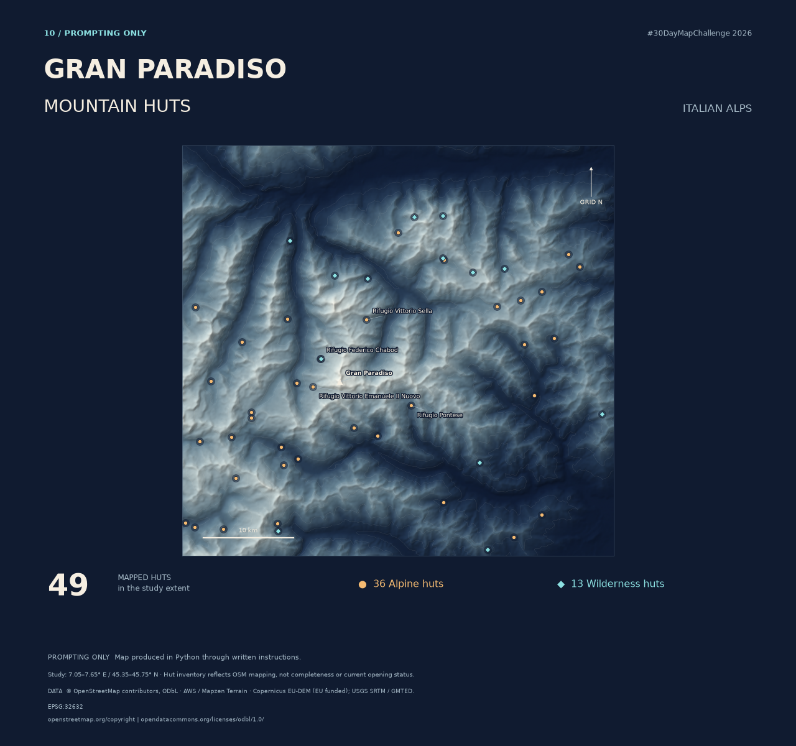

# 30DayMapChallenge 2026

Maps, reproducible Python, and editable QGIS projects by [LUCANM](https://github.com/LUCANM).

## Day 10 · Gran Paradiso — Mountain Huts

49 OpenStreetMap hut records set against shaded Alpine terrain. [View the map, download the files, and reproduce the workflow →](days/10-gran-paradiso-mountain-huts/)

Each entry includes the finished map, Python scripts, an editable QGIS project, data credits, reproduction instructions, and a record of checks performed.

To download everything, use **Code → Download ZIP** and extract it. Keep each day's folders together so the QGIS data links continue to work.

Third-party data retains its original terms. An additional license for original code and artwork has not yet been selected; consult each entry's credits before reuse.
