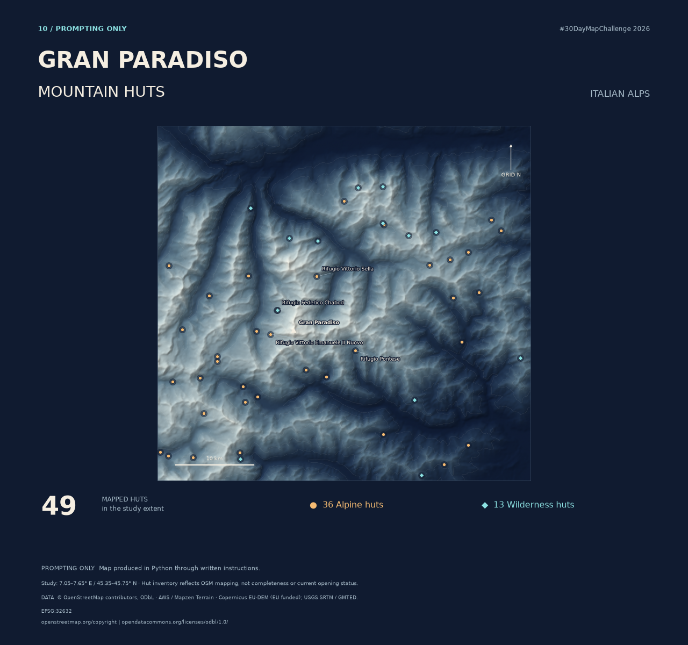

# Day 10 · Gran Paradiso — Mountain Huts

**30DayMapChallenge 2026 · Prompting only · Italian Alps**



A terrain-led portrait of mapped mountain shelters around Gran Paradiso. Warm circles mark **36 alpine-hut records**, ice-blue diamonds mark **13 wilderness-hut records**, and a triangle marks the summit. The study rectangle spans 7.05–7.65° E and 45.35–45.75° N; it is not the national park boundary.

## Explore and download

- [Finished map — high-resolution PNG](maps/Gran_Paradiso_Day10.png)
- [Editable QGIS project](qgis/Gran_Paradiso_Day10.qgs) — download the complete repository so the adjacent data and attachment archive stay available.
- [Python poster renderer](scripts/render_map.py)
- [QGIS project builder](scripts/create_qgis_project.py)
- [Source data and georeferenced terrain](data/)
- [Data credits and permissions](CREDITS.md)
- [Validation record](VALIDATION.md)
- [Recorded original brief](PROMPT.txt)

## How it was made

The supplied archive contains assistant-generated Python and prepared local data. The original workflow queried OpenStreetMap and decoded Mapzen Terrarium elevation tiles, then resampled elevation to a 75 m grid in WGS 84 / UTM zone 32N (EPSG:32632). The renderer combines shaded relief, 500 m contours, hut symbols, and selected source names.

The prompting-only interpretation is written instructions implemented through Python. The supplied brief is preserved as historical reference. For this portfolio revision, the offline renderer was made portable and explicit about UTF-8; an editable QGIS project was built using QGIS itself. This revision should not be presented as an unchanged original artifact.

## Reproduce the poster

Python 3.12 is the tested Python series. From the repository root:

```sh
python -m venv .venv
```

Activate it with `.venv\Scripts\activate` on Windows Command Prompt, or `source .venv/bin/activate` on macOS/Linux. Then:

```sh
python -m pip install -r days/10-gran-paradiso-mountain-huts/requirements.txt
python days/10-gran-paradiso-mountain-huts/scripts/render_map.py
```

The script reads bundled inputs and writes `maps/Gran_Paradiso_Day10.png` (3200 × 3000 pixels) and `maps/preview.png` (1280 × 1200). It resolves input and output paths from its own location, so a different working directory is supported. No data download or account is needed after dependencies are installed.

## Open and edit in QGIS

1. Download the full repository ZIP from GitHub's **Code → Download ZIP**, then extract it.
2. Open `qgis/Gran_Paradiso_Day10.qgs` in QGIS 3.40 or later. Keep the `data`, `maps`, `scripts`, and `qgis` folders together. Keep the QGIS attachments ZIP beside the project.
3. Edit hut attributes, symbols, or layer visibility. Elevation is included but hidden by default; terrain relief is visible.

The QGIS project contains editable point layers and georeferenced terrain. The poster typography and layout are produced by Python; there is no equivalent QGIS print layout. [QGIS map-canvas preview](maps/qgis-preview.png).

To rebuild the project, use a Python environment supplied by a QGIS installation, not the ordinary poster environment. In the Windows OSGeo4W Shell supplied with QGIS:

```sh
python-qgis-ltr days/10-gran-paradiso-mountain-huts/scripts/create_qgis_project.py
```

For another QGIS installation, invoke the same script with that installation's configured PyQGIS interpreter. QGIS is not installed by `requirements.txt`.

## Interpretation and limitations

These are OSM records, not independently verified distinct operating facilities. Mapping completeness, current opening, access, and safety are not assessed. Nodes retain their mapped coordinates; ways and relations use Overpass bounding-box centres, which may not be entrances or lie inside a feature. Elevation shading is artistic and does not describe current snow or vegetation. Resampling to 75 m does not increase source accuracy.

The supplied source JSON records an OSM database timestamp of 2026-10-02T05:59:14Z. The original notes report retrieval on 2 October 2026; this is inherited provenance, not an independently observed download date. Exact terrain source contributions within individual pixels are not available in the supplied archive.

## Sharing

OSM-derived data is distributed under ODbL 1.0; terrain retains its source-specific terms. See [CREDITS.md](CREDITS.md). An additional open license for original code and artwork has not been selected. Public visibility alone does not grant an unrestricted reuse license.
